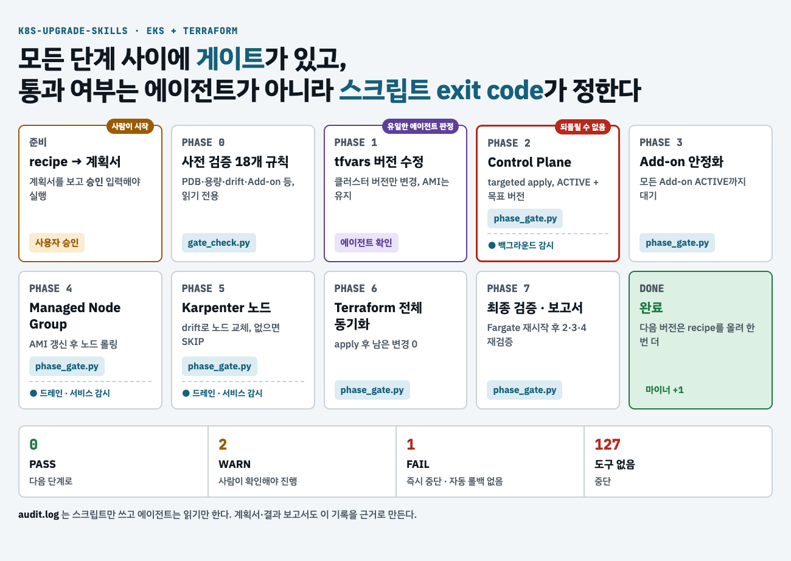

# K8s Upgrade Skills

**Terraform으로 관리하는 Amazon EKS** 클러스터의 마이너 버전 업그레이드를 AI Agent가 단계별로 수행하도록 하는 **Skills** 모음입니다.

에이전트가 `recipe.md`를 읽고 사전 검증 → Control Plane → Add-on → 노드 → 최종 검증까지 진행합니다. 각 단계 사이에는 Python 스크립트가 exit code로 판정하는 **게이트**가 있어, 실패하면 에이전트가 우회하지 못하고 멈춘 뒤 보고합니다.

- **대상**: EKS + Terraform. Karpenter + Fargate 구성으로 실 프로덕션에서 사용했습니다(1.33→1.35, 버전당 1회씩 실행).
- **라이선스**: [MIT](LICENSE)

> **책임 범위**: 이 스킬은 판단을 돕는 도구입니다. 실제 인프라 변경의 최종 책임은 실행자에게 있습니다. 프로덕션에서는 각 Phase 결과를 직접 확인하고 진행하세요.

## 업그레이드 흐름



| 단계 | 하는 일 | 게이트 (판정 주체) |
|------|---------|-------------------|
| 준비 | `recipe.md` 확인(없으면 대화로 생성) → 계획서 생성 | `validate_recipe.py` · 사용자가 `승인`/`확인`/`시작` 입력 |
| Phase 0 | 18개 사전 검증 규칙 (읽기 전용) | `gate_check.py` |
| Phase 1 | tfvars의 `eks_cluster_version`만 목표 버전으로 수정 (AMI는 유지) | 에이전트가 grep으로 확인 — **스크립트가 아닌 유일한 게이트** |
| Phase 2 | Control Plane 업그레이드 (targeted apply, 되돌릴 수 없음) | `phase_gate.py phase2` — ACTIVE + 목표 버전 |
| Phase 3 | Add-on 안정화 대기 | `phase_gate.py phase3` — 전 Add-on ACTIVE |
| Phase 4 | Managed Node Group 롤링 (AMI alias 갱신) | `phase_gate.py phase4` — 전 노드 Ready + 비정상 Pod 없음 |
| Phase 5 | Karpenter drift 노드 교체 (없으면 SKIP) | `phase_gate.py phase5` — NodeClaim 목표 버전 |
| Phase 6 | Terraform 전체 동기화 | `phase_gate.py phase6` — 남은 변경 없음 |
| Phase 7 | Fargate Pod 재시작 → Phase 2·3·4 재검증 → 보고서 | `phase_gate.py phase7` |

**게이트 exit code**: `0` 진행 · `2` 사용자 확인 후 진행 · `1` 즉시 중단 · `127` CLI 도구 없음

**백그라운드 감시**: Phase 2·4·5 동안 에이전트가 감시 스크립트를 함께 띄웁니다.
- `drain_watch.py` — Warning 이벤트, PDB 차단, NodeClaim 상태를 30초마다 확인
- `service_watch.py` — recipe에 `services`가 있을 때만. EndpointSlice ready 수 + HTTP 헬스체크

**audit.log**: 모든 게이트와 감시 결과가 이 파일 하나에 누적됩니다. 쓰는 쪽은 스크립트뿐이고 에이전트는 읽기만 합니다. 계획서·결과 보고서도 이 기록을 근거로 작성됩니다.

## 하지 않는 것

- **자동 해결·자동 롤백 없음** — CRITICAL을 감지하면 멈추고 보고만 합니다. PDB 수정, 노드 추가, PV 재배치는 사용자가 합니다. Control Plane 업그레이드는 되돌릴 수 없습니다.
- **무중단 보장 없음** — 위험을 미리 찾지만, 무중단을 검증하거나 보장하지 않습니다.
- **한 번에 한 마이너 버전만** — 1.33 → 1.35는 1.33 → 1.34, 1.34 → 1.35로 두 번 실행합니다.
- **워크로드 Spec 수정 안 함** — PDB, replica 수, 노드 프로비저닝은 건드리지 않습니다.
- **Self-managed Node Group 미지원** — Managed Node Group · Karpenter · Fargate Pod 재시작만 다룹니다.
- **EKS·Terraform 외 미지원** — 온프레미스, eksctl·CDK·Pulumi는 대상이 아닙니다.
- **Managed Node Group 롤링(Phase 4)은 실 환경 검증 이력 없음** — 코드는 있지만, 실제로 검증된 경로는 Karpenter + Fargate입니다.

항목별 이유와 대안은 [QnA.md](QnA.md), 실패 시 대응은 [docs/failure-runbook.md](docs/failure-runbook.md)를 보세요.

## 시작하기

### 1. 전제조건

- `python3` 3.9+, `kubectl`, `aws` CLI, `terraform`이 PATH에 있어야 합니다. (`helm-k8s-compat`을 쓰려면 `helm` v3+)
- 대상 클러스터에 `kubectl`과 `aws`가 붙어 있어야 합니다. MFA·assume-role 래퍼를 쓴다면 recipe의 `auth_prefix`에 넣습니다.
- 필요한 IAM·RBAC 권한: [docs/required-permissions.md](docs/required-permissions.md)

| 단계 | IAM | RBAC |
|------|-----|------|
| Phase 0 (사전 검증) | EKS/SSM/EC2 읽기 전용 | `k8s-upgrade-preflight` |
| Phase 1~7 (실행) | + EKS 업데이트 + Terraform State | `k8s-upgrade-execution` |

### 2. 설치

```bash
git clone https://github.com/HaeDalWang/k8s-upgrade-skills.git
cd k8s-upgrade-skills
./install.sh --tool claude    # claude | kiro | cursor | antigravity, 생략하면 대화형 선택
```

`install.sh`는 `k8s-upgrade-skills/`와 `helm-k8s-compat/` 두 스킬을 도구의 전역 스킬 경로에 복사합니다. 도구 설정 파일(mcp.json 등)은 건드리지 않습니다.

| 도구 | 설치 경로 |
|------|----------|
| Claude Code | `~/.claude/skills/` |
| Kiro | `~/.kiro/skills/` |
| Cursor | `~/.cursor/skills/` |
| Antigravity | `~/.agent/skills/` |

```bash
./install.sh --all         # 모든 도구에 설치
./install.sh --force       # 재설치(업데이트)
./install.sh --status      # 설치 상태 확인
./install.sh --uninstall   # 전체 제거
```

### 3. 실행

Terraform 코드가 있는 프로젝트 디렉터리에서 에이전트에게 요청합니다.

```
EKS 클러스터를 업그레이드해줘
```

`recipe.md`가 없으면 에이전트가 필요한 값을 한 번에 묻고 만듭니다. 계획서가 나오면 검토 후 `승인`, `확인`, `시작` 중 하나를 입력해야 실행이 시작됩니다.

테스트할 클러스터가 없다면 [example/terraform-eks/](example/terraform-eks/)의 EKS + Karpenter 참조 인프라와 위험 시나리오 샘플로 바로 배포해 볼 수 있습니다.

## 설정

### recipe.md

직접 작성하려면 프로젝트 루트에 YAML frontmatter 형식으로 만듭니다. 기존 `recipe.yaml`도 읽지만, 본문에 자유 형식 컨텍스트를 적을 수 있는 `recipe.md`를 권장합니다.

```markdown
---
environment: aws          # aws (고정)
platform: eks             # eks (고정)
iac: terraform            # terraform (고정)
cluster_name: my-cluster
current_version: "1.34"   # 따옴표 필수
target_version: "1.35"    # 따옴표 필수, current_version + 1 마이너

# 선택 항목
output_language: ko       # ko | en
auth_prefix: ""           # terraform/aws 명령 앞에 붙일 래퍼 (예: "aws-runas my-profile")
tf_var_file: ""           # terraform var-file (예: "dev.tfvars")

# 서비스 가용성 감시 (선택) — 없으면 service_watch를 띄우지 않음
services:
  - name: my-api
    namespace: production
    min_endpoints: 2
    health_check_url: "https://api.example.com/health"
  - name: my-worker
    namespace: production
    min_endpoints: 1      # health_check_url 없음 → EndpointSlice만 확인
---

## 업그레이드 컨텍스트

(작업 시간대, 무중단 요구, 진행 중인 이슈 등을 자유롭게 적으면 계획서의 Phase별 주의사항에 반영됩니다)
```

Terraform 디렉터리와 EKS 모듈 이름은 에이전트가 찾아내므로 recipe에 적지 않습니다.

**`services` 감시 수준**

| 설정 | 확인하는 것 | 한계 |
|------|-----------|------|
| `health_check_url` 있음 | EndpointSlice ready 수 + HTTP 응답 | 트래픽 레벨까지 감시 |
| `health_check_url` 없음 | EndpointSlice ready 수만 | Pod 레벨만. ALB/Ingress 전파 지연으로 생기는 일시적 5xx는 못 잡음 |

`health_check_url`은 에이전트가 실행되는 곳에서 접근 가능한 URL이어야 합니다(VPC 내부 전용 URL 불가).

### Claude Code 권한 (선택)

`.claude/settings.local.json`에 미리 허용해 두면 명령마다 승인을 묻지 않습니다. 허용 목록과 별개로, 실행 시작 전 계획서 승인 단계는 항상 거칩니다.

```json
{
  "permissions": {
    "allow": [
      "Bash(python3 k8s-upgrade-skills/scripts/*)",
      "Bash(python3 scripts/*)",
      "Bash(kubectl get *)",
      "Bash(kubectl describe *)",
      "Bash(kubectl patch *)",
      "Bash(kubectl scale *)",
      "Bash(kubectl delete pod*)",
      "Bash(aws eks *)",
      "Bash(aws ssm *)",
      "Bash(terraform plan*)",
      "Bash(terraform apply*)",
      "Bash(terraform show*)",
      "Bash(find . *)",
      "Bash(grep *)",
      "Bash(jq *)",
      "Bash(curl -sf*)"
    ]
  }
}
```

- `kubectl patch/scale/delete`는 Phase 0 CRITICAL 해소 조치(PDB 수정, padding Pod 삭제 등)에 씁니다. 읽기 전용 검증만 원하면 빼세요.
- `jq`, `curl`은 Phase 2 타임아웃 감지(MNG 상태 확인)와 `service_watch.py` 헬스체크에 씁니다.

## 사전 검증 규칙 (18개)

모두 `gate_check.py`가 판정합니다.

| 카테고리 | 규칙 수 | 검증 내용 |
|----------|---------|----------|
| common | 5 | 클러스터 상태, 버전 호환성, kubelet skew, Add-on 호환성, EKS Insights 업그레이드 준비도(제거·Deprecated API) |
| workload-safety | 6 | PDB 차단, 단일 레플리카, PV AZ 고정, 로컬 스토리지, 장시간 Job, 토폴로지 제약 |
| capacity | 3 | 노드 용량 여유, 리소스 압박 Pod, Surge 용량 |
| infrastructure | 4 | Terraform drift, AMI 가용성, Karpenter 호환성, Recreate 감지 |

심각도: `CRITICAL` 즉시 중단 · `HIGH` 사용자 확인 · `MEDIUM` 보고만 · `LOW` 참고

## 함께 설치되는 스킬: helm-k8s-compat

설치된 Helm 차트가 대상 K8s 버전을 지원하는지 미리 점검하는 독립 스킬입니다. 트리거: "Helm 차트 호환성 점검해줘". 지금은 업그레이드 스킬과 연결돼 있지 않아 따로 실행합니다.

EKS Insights·kubent는 API 서버에 실제 호출된 API만 봅니다. 업그레이드를 깨는 원인은 대부분 "이 차트 버전이 대상 K8s를 지원하는가"이고, 이 정보는 릴리스 노트와 지원 매트릭스에만 있습니다. 이 스킬은 de-facto 표준 차트 31종을 큐레이션한 registry와 라이브 `helm` 조회를 대조해 다음을 찾습니다.

- **지원 버전 범위 초과** — 예: ingress-nginx 4.13.x의 상한은 K8s 1.33 → 1.34 전에 차트부터 올려야 함
- **K8s가 요구하는 최소 차트 버전 미달** — 예: K8s 1.36은 Karpenter 1.13+ 필요
- **retirement / EOL** — 차트 전체 retirement(ingress-nginx 2026-03), release별 EOL(cert-manager)
- **K8s API 제거 충돌** — PSP, v1beta1 Ingress 등
- **수동 업그레이드 함정** — Helm이 자동 처리하지 않는 CRD 재적용, IAM 정책, webhook 전환

```bash
--current 1.35 --target 1.36   # 업그레이드 전 점검
--current 1.35 --target 1.35   # 정기 점검: 지금 버전 기준으로 이미 지원 범위 밖인 차트
```

registry에 없는 차트는 통과시키지 않고 "수동 검토 필요"(INFO)로 보고합니다. 큐레이션은 사람이 옮겨 적은 스냅샷이라 시간이 지나면 낡으므로, 항목마다 `last_verified`를 남기고 오래된 근거로 "문제 없음"을 낸 경우 그 사실도 함께 보고합니다.

근거 등급(공식 매트릭스 / 공식 문서 / 차트 실측 / kubeVersion만 / 커뮤니티)과 등급별로 주장할 수 있는 범위, exit code는 [helm-k8s-compat/registry/_schema.md](helm-k8s-compat/registry/_schema.md)와 [helm-k8s-compat/SKILL.md](helm-k8s-compat/SKILL.md)에 있습니다.

## 로드맵

| 기능 | 상태 |
|------|------|
| helm-k8s-compat을 Phase 0에 **경고**로 연결 (차트 버전이 낮다고 바로 장애가 나지는 않고, 우선순위는 K8s 버전이므로 차단 게이트는 아님) | 진행 중 |
| registry 근거 등급 올리기 — 차트 실측 수준 항목을 공식 문서·매트릭스 조사로 보강 | 진행 중 |
| 실패 시점 클러스터 상태 스냅샷 자동 저장 + AI 원인 분석 리포트 | 계획됨 |

## 왜 만들었나

EKS 업그레이드는 위험하고, 단계가 많고, 오래 걸립니다. 이 프로젝트는 개인의 인프라 트러블슈팅 노하우를 AI Agent의 Skill로 명세화하면, 작업을 더 안전하게 하면서 엔지니어의 시간을 다른 일에 돌릴 수 있다는 가설에서 출발했습니다.

1. **단순 질의응답** — 일반 챗봇은 빠르게 바뀌는 오픈소스 생태계의 버전·의존성을 정확히 따라가지 못했습니다.
2. **컨텍스트 결합** — Cursor·Kiro·Claude Code·Antigravity에 시스템 프롬프트와 MCP를 붙이고 AWS 공식 문서로 팩트체크하게 했습니다. 문제 해결은 나아졌지만, 사전 작업·실시간 대응·사후 검증이 이어지는 작업은 여전히 사람이 전체 흐름을 쥐고 있어야 했습니다.
3. **Skill로 구조화** — 수동 절차 자체를 에이전트가 따라 실행하는 Skill로 옮겼습니다. 5,000줄이 넘는 Helm values 같은 파일을 사람이 Ctrl+F로 훑는 대신 에이전트가 분석하고, 진행 과정이 `audit.log`와 Markdown 보고서로 남아 계획서·결과 보고서를 따로 쓸 필요가 줄었습니다.

목표는 작업 난이도를 낮추는 것입니다. 프로덕션에서 한 번의 휴먼 에러가 장애로 이어지는 일을 구조로 막고, 주기적으로 돌아오는 업그레이드의 부담을 덜어, 아낀 시간을 학습과 핵심 업무에 쓰는 것입니다.

## 프로젝트 구조

```
├── k8s-upgrade-skills/        # 업그레이드 스킬
│   ├── SKILL.md               #   진입점: recipe 검증 → 계획서·승인 → 하위 스킬 선택
│   ├── aws/terraform-eks/     #   Phase 0~7 실행 절차, 계획서·보고서 템플릿
│   ├── scripts/               #   게이트·감시 스크립트 (gate_check, phase_gate, drain_watch, service_watch …)
│   ├── docs/                  #   백그라운드 감시 설계 근거
│   └── schemas/               #   recipe.yaml IDE 스키마
├── helm-k8s-compat/           # Helm 차트 호환성 점검 스킬 (scripts/, registry/)
├── docs/                      # 필요 권한, 실패 대응 runbook
├── example/terraform-eks/     # EKS + Karpenter 참조 Terraform + recipe.md 예제
├── tests/                     # 스크립트 단위·통합 테스트
├── install.sh
└── QnA.md
```
